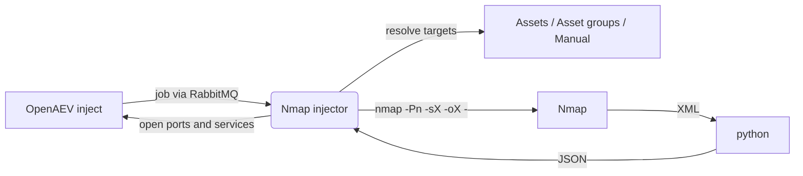

# OpenAEV Nmap Injector

The Nmap injector lets OpenAEV run network port scans as part of attack scenarios using
[Nmap](https://nmap.org/), the open-source network mapper. It exposes ready-to-use inject contracts (SYN, TCP Connect
and FIN scans), resolves the targets from your OpenAEV assets or from manual input, runs the scan, and reports the
discovered open ports and services back to OpenAEV as structured results.

## Table of Contents

- [OpenAEV Nmap Injector](#openaev-nmap-injector)
  - [Table of Contents](#table-of-contents)
  - [Introduction](#introduction)
  - [How it works](#how-it-works)
  - [Requirements](#requirements)
  - [Configuration variables](#configuration-variables)
    - [OpenAEV environment variables](#openaev-environment-variables)
    - [Base injector environment variables](#base-injector-environment-variables)
  - [Deployment](#deployment)
    - [Docker Deployment](#docker-deployment)
    - [Manual Deployment](#manual-deployment)
  - [Usage](#usage)
  - [Inject contracts](#inject-contracts)
  - [Target selection](#target-selection)
  - [Per-target outcomes and status](#per-target-outcomes-and-status)
    - [Large asset groups and the platform timeout](#large-asset-groups-and-the-platform-timeout)
  - [Behavior](#behavior)
  - [Debugging](#debugging)
  - [Additional information](#additional-information)

## Introduction

OpenAEV (Breach and Attack Simulation) drives injectors to execute the technical actions of a scenario. The Nmap
injector registers a set of scan contracts with the OpenAEV platform; when an inject using one of these contracts is
played, OpenAEV dispatches a job to the injector, which performs the corresponding Nmap scan and returns the results.

## How it works

Injectors receive their jobs through the message broker (RabbitMQ) configured by the OpenAEV platform. The injector
fetches the broker connection details from OpenAEV at startup, so it only needs to be able to reach the OpenAEV URL and
the RabbitMQ host/port advertised by the platform.

## Requirements

- OpenAEV Platform >= 1.19.0, reachable from the injector (along with its RabbitMQ broker)
- For a manual (non-Docker) deployment:
  - Python >= 3.14 and [Poetry](https://python-poetry.org/) >= 2.1
  - The `nmap` binary available on the `PATH` (the Docker image already bundles them)

## Configuration variables

The injector is configured either through environment variables (recommended, read from `docker-compose.yml` / the
`.env` file for a Docker deployment) or through a `config.yml` file (for a manual deployment). Copy the provided
`.env.sample` / `config.yml.sample` and fill in the values flagged with `ChangeMe`.

### OpenAEV environment variables

| Parameter         | config.yml          | Docker environment variable | Mandatory | Description                                                                        |
|-------------------|---------------------|-----------------------------|-----------|------------------------------------------------------------------------------------|
| OpenAEV URL       | `openaev.url`       | `OPENAEV_URL`               | Yes       | The URL of the OpenAEV platform. Must be reachable from where the injector runs.   |
| OpenAEV Token     | `openaev.token`     | `OPENAEV_TOKEN`             | Yes       | The administrator token of the OpenAEV platform.                                   |
| OpenAEV Tenant ID | `openaev.tenant_id` | `OPENAEV_TENANT_ID`         | No        | Tenant identifier for multi-tenant deployments. When set, it must be a valid UUID. |

### Base injector environment variables

| Parameter     | config.yml           | Docker environment variable | Default | Mandatory | Description                                                     |
|---------------|----------------------|-----------------------------|---------|-----------|-----------------------------------------------------------------|
| Injector ID   | `injector.id`        | `INJECTOR_ID`               | /       | Yes       | A unique `UUIDv4` identifier for this injector instance.        |
| Injector Name | `injector.name`      | `INJECTOR_NAME`             | Nmap    | No        | The name of the injector as shown in OpenAEV.                   |
| Log Level     | `injector.log_level` | `INJECTOR_LOG_LEVEL`        | error   | No        | Verbosity of the logs. One of `debug`, `info`, `warn`, `error`. |

### Nmap environment variables

| Parameter                | config.yml                          | Docker environment variable         | Default | Description |
|--------------------------|-------------------------------------|-------------------------------------|---------|-------------|
| Default host timeout     | `nmap.default_host_timeout_seconds` | `NMAP_DEFAULT_HOST_TIMEOUT_SECONDS` | 300     | `--host-timeout` (seconds) used when an inject leaves *Give up on a host after* empty. `0`: no default (nmap's own, unbounded). |
| Default max retries      | `nmap.default_max_retries`          | `NMAP_DEFAULT_MAX_RETRIES`          | 2       | `--max-retries` used when an inject leaves *Max retries per port* empty. |
| Scan time limit          | `nmap.scan_timeout`                 | `NMAP_SCAN_TIMEOUT`                 | /       | Whole-run ceiling in seconds. Unset: the platform's inject execution threshold minus 60 s, or 540 s when the platform does not expose it. |

### Timing defaults and the scan time limit

An empty timing field no longer leaves the scan unbounded: the injector applies `--host-timeout 300s` and
`--max-retries 2` (tunable above). A value set on the inject, `0` included, always wins; the timing template keeps
nmap's default. Existing injects get these defaults with no edit.

The whole run is bounded by a scan time limit: the inject field *Scan time limit in seconds*
(`scan_timeout_seconds`), else `NMAP_SCAN_TIMEOUT`, else derived from the platform inject execution threshold. Any
limit is capped 60 s below that threshold, past which the platform finalizes the inject and refuses late results.
When the limit is reached nmap is terminated, the hosts it finished are kept (one trace each, ports and services in
the structured output), every other target gets `not scanned, scan time limit reached`, and the inject ends
`WARNING` (`ERROR` when no host was finished). The terminal callback is always sent.

## Deployment

### Docker Deployment

This injector depends on the shared `injector_common` package, so the image must be built with a build context that
exposes it:

```shell
docker build --build-context injector_common=../injector_common . -t openaev/injector-nmap:latest
```

Create a `.env` file from `.env.sample` and fill in your values, then start the injector with the provided
`docker-compose.yml`:

```shell
docker compose up -d
```

> If OpenAEV runs on your host machine while the injector runs in a container, set `OPENAEV_URL` to
> `http://host.docker.internal:<port>` rather than `localhost`. On Linux, also add
> `extra_hosts: ["host.docker.internal:host-gateway"]` to the service, and make sure OpenAEV listens on `0.0.0.0`.

### Manual Deployment

Make sure `nmap` is installed and on your `PATH`, create a `config.yml` from `config.yml.sample`, then install
and run the injector:

```shell
poetry install
poetry run python -m nmap.openaev_nmap
```

> For local development against a checkout of [client-python](https://github.com/OpenAEV-Platform/client-python)
> (cloned next to this repository), use `poetry install --extras dev`.

## Usage

Once started, the injector registers its contracts with OpenAEV and waits for jobs. Add an Nmap inject to a scenario or
atomic testing, select the scan type and the targets, and play it: the results are attached to the inject once the scan
completes.

## Inject contracts

| Contract              | Scan type        | Command executed             |
|-----------------------|------------------|------------------------------|
| Nmap - SYN Scan       | TCP SYN scan     | `nmap -Pn -sS -oX - <targets>` |
| Nmap - TCP Connect Scan | TCP connect scan | `nmap -Pn -sT -oX - <targets>` |
| Nmap - FIN Scan       | TCP FIN scan     | `nmap -Pn -sF -oX - <targets>` |
| Nmap - SYN Scan with service/version detection | TCP SYN scan plus service/version detection | `nmap -Pn -sS -sV -oX - <targets>` |

`-Pn` skips host discovery (treat all hosts as online). Nmap output is produced as XML (`-oX -`) and converted to JSON before being parsed into open ports and services.

### Service labels: guessed or probed

Without version detection, nmap does not probe the services: it names each open port from its static port table, so an
open 9100/tcp is always `jetdirect` (a printer), whatever really listens on it. Each `scan_results` entry says how its
service was identified:

| Contract | `service` | `service_confidence` | Extra keys |
|----------|-----------|----------------------|------------|
| SYN, TCP Connect, FIN | `jetdirect, guessed from port` | `guessed` | none |
| SYN with service/version detection | `http, Prometheus node_exporter 1.x` (name, product, version, extra info) | `probed` | `service_product`, `service_version`, `service_extrainfo` when nmap reports them |

A port version detection could not identify keeps its port-table name, marked `guessed`. The keys used for chaining
(`asset_id`, `host`, `port`, `service`) are unchanged. Version detection sends probes to every open port: it is slower
and noisier than the plain scans, which is why it is a contract of its own.

## Target selection

Targets are resolved through the shared selection logic of `injector_common`:

- Target selector: `assets`, `asset-groups` (default), or `manual`.
- Target property selector (for assets / asset groups): `automatic` (default), `seen_ip`, `local_ip` (first), or
  `hostname`.

| Target property   | Asset field used                                                                  |
|-------------------|-----------------------------------------------------------------------------------|
| Automatic         | See the order below                                                               |
| Seen IP           | `asset_seen_ip`                                                                   |
| Local IP (first)  | First valid entry in `asset_ips`                                                  |
| Hostname          | `asset_hostname`                                                                  |

`Automatic` resolves each asset in this order:

1. An agentless asset (no agent installed) with a hostname is scanned at its `asset_hostname`.
2. Otherwise, at its `asset_seen_ip` (the address the platform saw the endpoint at) when it is a valid IP.
3. Otherwise, at the first valid entry of `asset_ips`.
4. Otherwise the asset is skipped (see below).

A valid IP is neither loopback, unspecified nor link-local. With `Automatic`, the execution message lists the field
used and the value for each asset, e.g. `asset web-01: hostname web-01.example.com (automatic, agentless)` or
`asset db-02: seen IP 203.0.113.5 (automatic)`.

A hostname is resolved by the DNS of the host the injector runs on. Results are attributed to assets by the address
and hostnames Nmap reports for each host, never by position.

For manual targets, provide hostnames or IP addresses as comma-separated values. Invalid, loopback and link-local
addresses are filtered out.

### Skipped assets

An asset that has no usable value for the target property is not scanned. It is reported on the inject, not only in
the injector log:

- one `WARNING` trace on that asset, e.g. `web-02: not scanned, seen IP 127.0.0.1 is loopback (target property
  seen_ip)` or `db-03: not scanned, no seen IP (target property seen_ip)`; an invalid value names the field and the
  value (loopback, unspecified, link-local, not a valid IP address);
- the execution message ends with `N of M assets skipped` and one line per skipped asset;
- the inject ends `WARNING` when at least one asset was skipped and the others were scanned;
- when every asset is skipped, Nmap is not run and the inject ends `ERROR` with that message.

Which value is chosen for each property does not change; the warning line in the injector log stays.

## Per-target outcomes and status

One Nmap run covers every target. After it, each asset-backed target gets one trace under its own target in the
execution view:

| Outcome                              | Trace status | Message                                                       |
|--------------------------------------|--------------|---------------------------------------------------------------|
| Host answered, with open ports       | `EXECUTED`   | `10.0.0.1 (asset web-01): host up, 2 open ports`              |
| Host answered, no open port          | `EXECUTED`   | `10.0.0.1 (asset web-01): host up, no open port`              |
| Host down or no response             | `WARNING`    | `10.0.0.2 (asset db-02): host down or no response`            |
| Hostname did not resolve             | `WARNING`    | `app.invalid (asset app-03): not scanned, hostname did not resolve` |
| IP with no result in the report      | `WARNING`    | `10.0.0.9 (asset db-09): not scanned, no result returned by the scan` |
| Not reached before the scan time limit | `WARNING`  | `10.0.0.7 (asset db-07): not scanned, scan time limit reached` |

With `-Pn` Nmap reports every host as up; a host counts as answering when at least one port is open, closed or
unfiltered. A manual target without an asset gets a trace only when it was not scanned.

The global status of the inject:

- `EXECUTED` when every target answered;
- `WARNING` (a successful execution on the platform) when some targets were missed, or when Nmap exited with a
  non-zero code but its report could be parsed and scanned at least one target (the results are kept, the exit
  code and Nmap's stderr are in the message);
- `ERROR` when the scan failed: Nmap exited with a non-zero code and scanned no target (the message carries the
  exit code and Nmap's stderr), or produced no usable report (the message is Nmap's stderr).

Nmap's stderr is trimmed and capped at 1,000 characters in the message.

The global message starts with the counts, e.g. `2/3 targets scanned, 1 up, 2 missed, 2 open ports`, then lists
the targets that were missed.

### Large asset groups and the platform timeout

Before the run, an `INFO` trace states the number of targets. The platform finalizes an inject still running after
`inject.execution.threshold.minutes` (default 10) as timed out with the `ERROR` status. A result Nmap sends later is
still recorded (ports, structured output), but the inject keeps the `ERROR` status. The scan time limit (see
[Timing defaults and the scan time limit](#timing-defaults-and-the-scan-time-limit)) stops nmap before that
threshold and keeps the hosts already scanned. To scan a large group whole, raise `inject.execution.threshold.minutes`
on the platform, or split the group.

## Behavior



On each job the injector acknowledges reception, resolves the targets, builds and runs the Nmap command, uses Python to convert the XML to JSON, parses the open ports and services, and returns a structured result (linked to the scanned
asset when applicable), one outcome trace per target and a global status (see
[Per-target outcomes and status](#per-target-outcomes-and-status)).

## Debugging

Set `INJECTOR_LOG_LEVEL=debug` to log the resolved targets and the exact Nmap command line that is executed. For manual
deployments, the most common issue is a missing `nmap` binary on the `PATH`.

## Additional information

- Official Nmap documentation: [https://nmap.org/docs.html](https://nmap.org/docs.html)
- Scan option reference: `-Pn` (skip host discovery), `-sS` (SYN scan), `-sT` (TCP connect scan), `-sF` (FIN scan), `-sV` (service/version detection).
